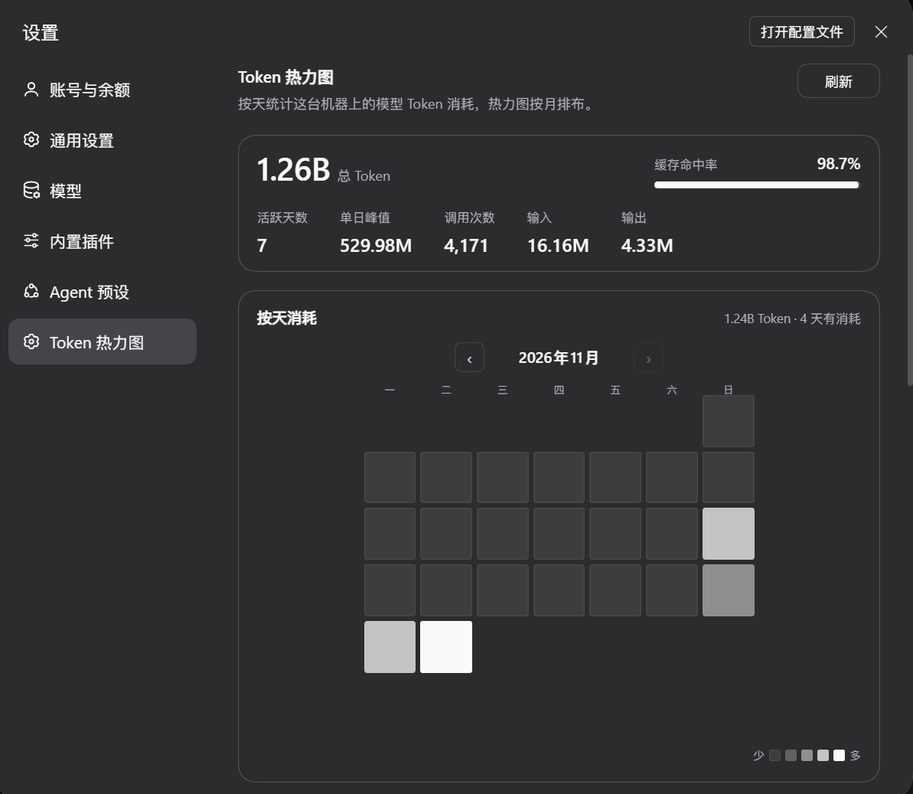
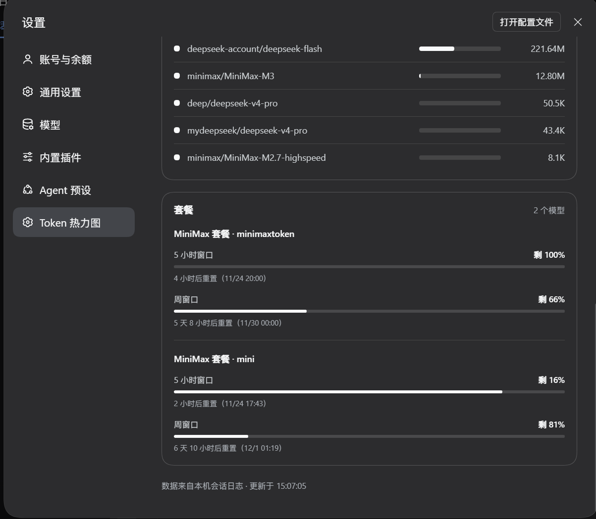
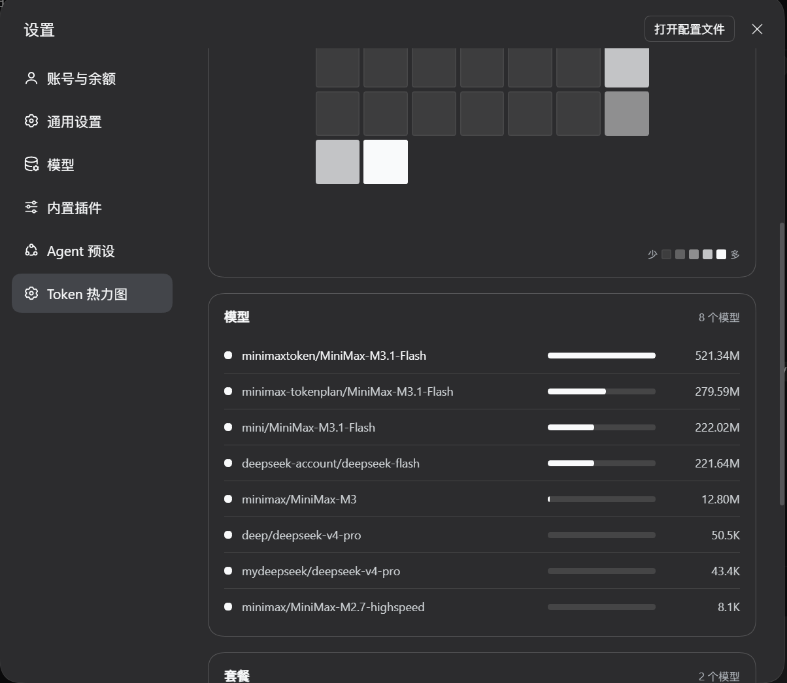
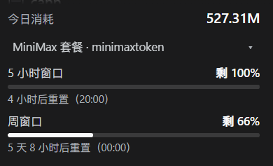
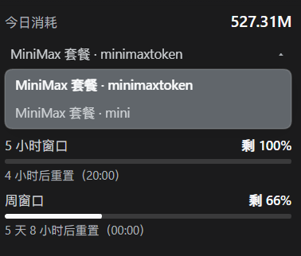

# @xiaolong54/dsh-token-heatmap

A dsh bundle that shows how many tokens the models on this machine spent,
day by day, as a month-by-month heatmap — and how much of each coding plan
is left.

## Screenshots

### The heatmap

The daily consumption of every model, one month at a time. A day without
usage keeps an empty cell, a day that has not happened yet stays blank, and
the four shades are the quartiles of the days that carry usage. Hovering a
cell shows that day's tokens and calls.



### The plans

Every coding plan the machine is connected to, one bar per window — the
short interval window and the weekly one — with how long is left until each
resets.



### The per-model breakdown

Every model that has ever run on this machine, with its share of the total.
Picking a model narrows the heatmap to it.



### The sidebar card

Above the account row: what today cost, and the remaining quota of the
connected plans.



The plan name opens a switcher, so a machine with several plans picks which
one the card shows.



## What it does

- **Host half** (`index.js`): folds every session in the corpus into per-day,
  per-model token buckets. Each `assistant/message` event carries the
  provider usage of that call and the route (`provider` and `model`) that
  produced it, so the totals cover history that predates the plugin. The
  fold runs in the background and its per-session result is kept in a
  ledger file in the profile state; the browser reads the merged totals
  from `GET /token-heatmap/usage`, behind the composition's connection trust
  fence, so the page never waits for a fold.
- **Client half** (`client.js`): two surfaces — a settings page with the
  month-by-month heatmap, the totals, the per-model breakdown and every
  connected plan, and a small card above the account row that shows what
  today cost and the plan the user picked.
- **Vendor registry** (`plans.js`): one entry per coding-plan vendor, with
  the endpoint, the authentication and the parsing. Covered today: MiniMax,
  CommandCode, Kimi For Coding, GLM / Z.ai, OpenCode Go and Codex / ChatGPT.
- **A plan that shows up on its own**: the Host fingerprints the configured
  routes, so a route that was added to the profile makes the plan rows stale
  and the next read asks the providers again. The refresh button asks them
  right away.

## A start that is honest

The Host keeps the plan rows of its last probe in the ledger file, so a start
shows the plans right away instead of an empty card. While the Host is still
asking the providers, the card says it is reading them; only a Host that
looked and found nothing says that no plan is connected. The browser reads
the route quickly until that answer is whole, and then slows down to the
normal interval.

## Layout

| Path | Role |
| --- | --- |
| `index.js` | Host half: the usage route and the background session fold |
| `plans.js` | The vendor registry: where to ask each provider and how to read it |
| `src/heatmap.js` | Pure grid, intensity and summary helpers |
| `src/page.js` | The settings page |
| `src/plans.js` | The plan card on the settings page |
| `src/sidebar.js` | The card above the account row |
| `src/usage.js` | The shared read of the Host route |
| `src/format.js` | The shared formatters |
| `src/tooltip.js` | The shared hover bubble |
| `src/i18n.js` | Chinese and English copy |
| `src/styles.js` | The stylesheet of both surfaces |
| `src/index.js` | Client registration |
| `build.mjs` | Builds `client.js` from `src/` |
| `tools/build-market-index.mjs` | Builds the plugin market index |
| `docs/screenshots/` | The images above |

## Build

```bash
node build.mjs
```

## Install

### From npm (no build permission needed)

```sh
npm add @xiaolong54/dsh-token-heatmap
```

The published tarball already carries the built client artifact, so nothing
runs at install time. This is the path the big community indexes pick up
automatically.

### From the plugin market

The bundle is listed in a plugin market index that installs this repository
at a pinned commit:

```
https://xiaolong54.github.io/dsh-token-heatmap/market/index.json
```

In dsh, open **Plugins → Discover → Add index source**, paste that URL,
then install **Token heatmap**.

A Git install fetches sources, so the client artifact is built on the
installing machine by this package's `prepare` script. pnpm refuses to run
it until the package is allowlisted, and the key it asks for is the exact
spec it prints — for a Git source that key names the commit:

```yaml
# pnpm-workspace.yaml in the dsh profile
allowBuilds:
  '@xiaolong54/dsh-token-heatmap@https://codeload.github.com/xiaolong54/dsh-token-heatmap/tar.gz/<commit>': true
```

Copy the key from the install error, then install again. Treat that
allowance as permission to run this package's code on your machine.

### From the command line

```sh
dsh plugin --profile desktop add github:xiaolong54/dsh-token-heatmap
```

## Publish a new version

```sh
git commit -am "…"
node tools/build-market-index.mjs   # rewrites docs/market/index.json with the new commit
git push
```

The index pins the commit it was built from, so a new commit is installed
only after the index is rebuilt and pushed. `npm publish` publishes the
built artifact, so users of the npm source never need the build permission.
