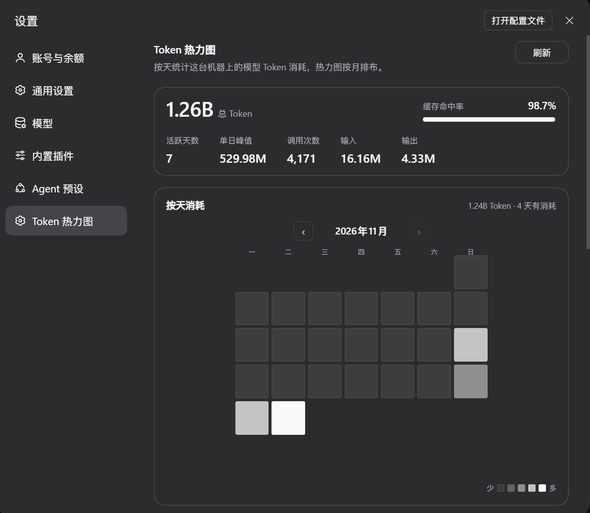
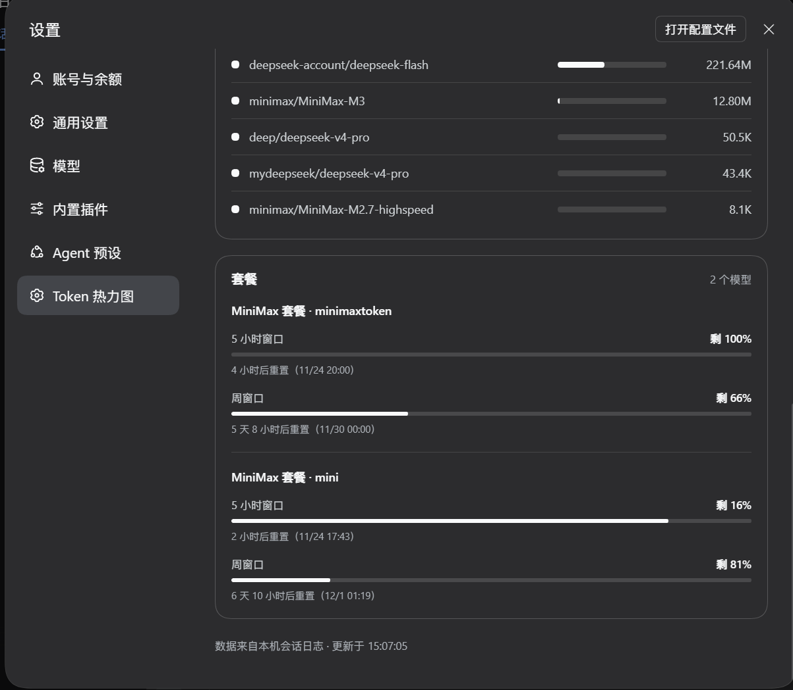
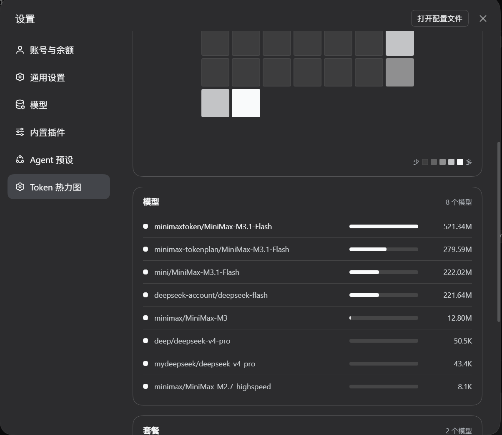
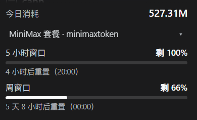

# Token heatmap

## Screenshots

## What it does

Adds two surfaces to the dsh web client:

- **`Settings → Token heatmap`** — the daily token consumption of every
  model, laid out as a month-by-month heatmap. Every month is its own block
  of the month's days, one cell per day, so a month reads as the thirty-odd
  cells it has. The page also shows the total token count, the cache hit
  rate, the number of active days, the busiest single day, the call count
  and the per-model breakdown; picking a model narrows the heatmap to it.
- **A sidebar card above the account row** — what today cost, plus what is
  left of the plans the machine is connected to. Every plan shows one bar per
  window (the short interval window and the weekly one) with how much of it
  is left and how long until it resets. A plan switcher next to the plan
  name picks which connected plan the card shows. No grid there: the card is
  a readout, the heatmap lives in Settings.
- **A plan card in Settings** — every connected plan at once, one block per
  plan with its bars, so all of them are visible without switching.

Hovering any cell shows that day's token count and call count.

## Where the numbers come from

The Host folds the session corpus, not a separate counter. Every
`assistant/message` event in a session log carries the provider usage of that
call — input, output, cache read and cache write tokens — and the route that
produced it. The Host walks every session, skips the events a forked session
inherited from its parent, and groups the usage by local day and by
`provider/model`.

Because the numbers come from the durable logs, the history is complete from
before the plugin was installed; there is no counting start date. A session
that cannot be read is skipped, and the rest of the corpus still answers.

## Why it opens fast

Folding the corpus never happens on the request path. The fold runs in the
background, its per-session result is kept in a ledger file in the profile
state, and the route answers from that ledger. The page therefore opens as
soon as the browser can reach the Host, and the numbers catch up behind it.

A quick refresh only re-reads the live sessions and the ones the ledger has
never seen; a full refresh re-reads everything every ten minutes, which is
how a cold log that changed outside this process is picked up.

## Where the plan remainders come from

The harness ships no plan or quota service of its own, so the Host asks each
provider itself. The route's own credential record is used when it has one
(an API key, or an OAuth grant for the routes that use one); otherwise the
environment reference the profile names is resolved through the harness's
credential store. The answer is checked for the provider's own envelope, not
only for the HTTP status, because MiniMax answers `200` with an error code
inside. A provider that does not answer keeps its last known row.

Every vendor is one entry in one registry, so covering another one is a data
change: which route ids and vendor hosts it answers on, where to ask, how to
authenticate, and how to read the answer. A route is matched by its harness
provider id, and a custom route id is matched by the vendor endpoint its
base URL points at — so a route named `my-mini` pointing at MiniMax still
resolves.

| Vendor | Endpoint | Windows |
|---|---|---|
| MiniMax | `…/v1/api/openplatform/coding_plan/remains` | the 5-hour interval window and the weekly window |
| Kimi For Coding | `…/coding/v1/usages` | one bar per limit row, plus the weekly summary |
| GLM / Z.ai | `…/api/monitor/usage/quota/limit` | one bar per quota unit (5-hour, week, month) |
| OpenCode Go | `…/zen/go/v1/usage` | rolling, weekly and monthly |
| Codex / ChatGPT | `…/backend-api/wham/usage` | the rate-limit windows the subscription reports |

### Vendors without an open quota endpoint

These were checked and have no endpoint a plugin can read with an API key, so
the plugin does not claim to cover them:

- **Qwen / DashScope 百炼 coding plan** — the token-plan hosts
  (`token-plan.*.maas.aliyuncs.com`) serve the OpenAI-compatible prefix but
  have no quota path there; the quota lives in the web console.
- **Tencent (混元 / CodeBuddy / Cloud Studio)** — the Hunyuan API answers
  only the signed Tencent Cloud protocol, and the coding-plan quota has no
  public endpoint.
- **Xiaomi MiMo token plan** — the token-plan hosts answer `404` on every
  quota path shape.
- **Volcengine Ark** — every path answers the same authentication error
  before routing, so no quota endpoint could be confirmed.

## Reading the heatmap

The shading follows the contribution-graph convention: the four cut points
are the quartiles of the days that carry usage, so a calm month does not look
busy and the busiest day still reads as the peak. A day without usage keeps
an empty cell; a day that has not happened yet stays blank.

## Limitations

- Only calls that reported usage are counted. A turn aborted before any
  content was streamed produces no assistant message and therefore no row.
- The daily boundary is the Host's local day.
- The refresh button asks the Host for a fresh fold; the answer it returns
  is the current ledger, so the newest minutes appear on the next poll.
